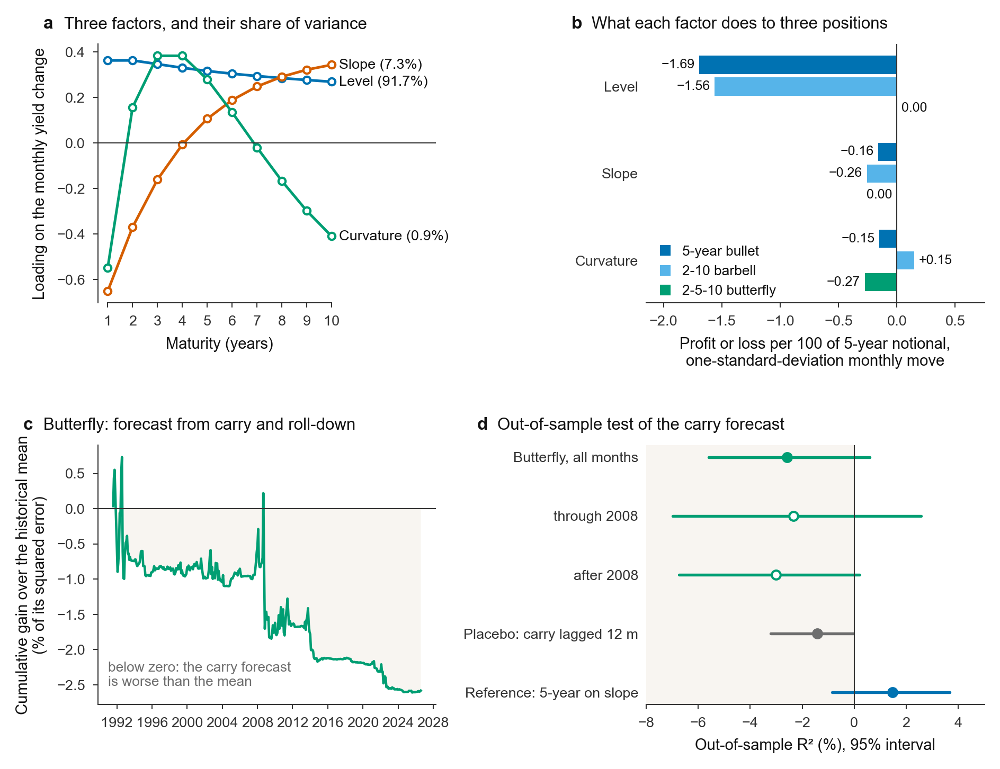

# Carry is not a forecast.

**Does the carry and roll-down of a Treasury butterfly predict its return over the next month?**

On the 1- to 10-year U.S. Treasury zero-coupon curve, 1971–2026, three factors account for 99.9% of monthly
yield changes, and a 2-5-10 butterfly built to ignore the first two is left holding curvature. Its carry and
roll-down is what the position earns if the curve does not move. Used as a forecast of next month's return, over
421 out-of-sample months, it does worse than the position's own historical mean: out-of-sample R² −2.6% (95% CI
−5.6% to +0.6%). The plan, the positions and the test were written down before the yield data were downloaded.

[](https://github.com/lyz44git/treasury-curve-carry/actions/workflows/tests.yml)



**Figure 1 | The curve's three factors and the test of carry.** **a**, Loadings of the first three principal components of monthly changes in the 1- to 10-year zero-coupon yields, with their share of variance. **b**, First-order profit or loss, per 100 of notional in the 5-year leg, of three positions under a one-standard-deviation monthly move of each factor. **c**, Cumulative squared-error gain of the carry forecast over the expanding historical mean, as a percentage of the mean's total squared error; the last point is the out-of-sample R². **d**, Out-of-sample R² with stationary-bootstrap 95% intervals (mean block 12 months). Drawn by [`figures/make_figure1.py`](figures/make_figure1.py).

> **Takeaways.**
> 1. **Risk.** Level explains 91.7% of monthly yield changes, slope 7.3% and curvature 0.9%. A 5-year bond is 97%
>    level risk. A 2-5-10 butterfly neutral to level and slope has a fifth of the bond's volatility (1.1% against
>    6.0% a year, per 100 of 5-year notional), of which 74% is curvature and 26% is none of the three factors.
> 2. **Forecast.** The butterfly's carry and roll-down does not predict its next-month excess return out of sample
>    (R² −2.6%, CI −5.6% to +0.6%), in either half of the sample, and no better than its own value 12 months
>    earlier. In sample the slope is 0.40 with a Newey-West t of 1.0.
> 3. **Why.** The carry moves slowly (autocorrelation 0.88) and is small: its monthly standard deviation is 0.7
>    basis points against 6.2 for the return. Even if carry were exactly the expected return, it could explain at
>    most 1.3% of the monthly variance.

## Question

1. **Risk.** How much of the monthly movement of the curve do level, slope and curvature explain, and what does
   each do to a bullet, a barbell and a butterfly?
2. **Forecast.** Does a butterfly's carry and roll-down predict its excess return over the next month better than
   its historical mean, out of sample?

## Data

| Series | Source | Coverage | License |
|---|---|---|---|
| Zero-coupon yields and Svensson parameters, daily | Federal Reserve, [Gürkaynak, Sack and Wright nominal yield curve](https://www.federalreserve.gov/data/nominal-yield-curve.htm) | 1961-06-14 to 2026-11-06; the 10-year yield from 1971-08-16 | Federal Reserve staff research product, public |
| One-month Treasury bill return, monthly | [Kenneth French data library](https://mba.tuck.dartmouth.edu/pages/faculty/ken.french/data_library.html), research factors file | 1926-07 to 2026-09 | Free for research use; not redistributed here |

Month-end curves from August 1971 to August 2026 give 661 monthly positions. Raw files are not stored in this
repository; `scripts/01_download.py` fetches them.

## Method

The plan is [`design/plan.md`](design/plan.md), committed before the data were downloaded. Step 0 checks and the
details the plan left open are in [`design/deviations.md`](design/deviations.md); nothing was changed after
results were seen.

| Element | Choice |
|---|---|
| Yields | Zero-coupon, continuously compounded, at 1 to 10 years and at each maturity less one month, evaluated from the published Svensson parameters (the formula reproduces the published yields to 0.0004 percentage points) |
| Return | One-month log return of each zero-coupon bond less the bill return |
| Carry and roll-down | The same return computed with the curve unchanged, using the bill return of the month just ended |
| Factors | Principal components of monthly yield changes |
| Butterfly | Long 5-year, short 2-year and 10-year; weights set each month so that exposure to the first two components, estimated on data up to that month, is zero |
| Forecast | Expanding-window regression of the butterfly's next-month excess return on its carry; first forecast 240 months into the sample |
| Benchmark | Expanding-window mean of the same return |
| Primary statistic | Out-of-sample R² over 421 months (August 1991 to August 2026), with a stationary bootstrap of the paired squared errors (mean block 12 months, 2,000 draws) |

**Reading rule, fixed in advance.** Carry "predicts" only if the primary interval is above zero.

## Results

### Part A. What moves the curve (`reports/part_a_*.csv`)

| | Level | Slope | Curvature |
|---|---|---|---|
| Share of variance, 1971–2026 | 91.7% | 7.3% | 0.9% |
| Share of variance, window ending 1991 | 93.7% | 5.5% | 0.6% |
| Loading at 2 / 5 / 10 years | 0.36 / 0.32 / 0.27 | −0.37 / 0.11 / 0.34 | 0.16 / 0.28 / −0.41 |

The loadings are stable: across eight expanding windows ending between 1991 and 2026, the level loading at five
years stays between 0.30 and 0.32.

Profit or loss per 100 of notional in the 5-year leg (first order):

| Position | Notional 2y / 5y / 10y | Level +1 sd | Slope +1 sd | Curvature +1 sd | Parallel +25 bp | Volatility a year |
|---|---|---|---|---|---|---|
| 5-year bullet | 0 / 100 / 0 | −1.69 | −0.16 | −0.15 | −1.23 | 6.0% |
| 2-10 barbell, same value and duration | 62.5 / 0 / 37.5 | −1.56 | −0.26 | +0.15 | −1.23 | 5.6% |
| 2-5-10 butterfly | −91.6 / 100 / −34.4 | 0.00 | 0.00 | −0.27 | +0.06 | 1.1% |

- The bullet and the barbell have the same value and duration and differ mainly in curvature, where their signs
  are opposite.
- The butterfly is neutral to the level factor, not to a parallel shift: the level factor moves short yields more
  than long ones, so a parallel shift of 25 bp still moves the position by 0.06.
- A quarter of the butterfly's variance (26%) is explained by none of the three factors. Once level and slope
  are removed, what remains includes the fitting error of the curve at the three maturities.

### Part B. Does carry predict the butterfly? (`reports/part_b_*.csv`)

| Out-of-sample R² | Estimate | 95% CI | Months |
|---|---|---|---|
| **Butterfly on its carry (primary)** | **−2.6%** | **−5.6% to +0.6%** | 421 |
| Mean block 6 / 24 months | −2.6% | −6.4% to +1.4% / −4.9% to −0.2% | 421 |
| Through December 2008 | −2.3% | −7.0% to +2.6% | 209 |
| After December 2008 | −3.0% | −6.7% to +0.2% | 212 |
| Placebo: carry observed 12 months earlier | −1.4% | −3.2% to −0.0% | 421 |
| Reference: 5-year bond on the 10-year minus 1-year slope | +1.5% | −0.9% to +3.7% | 421 |

Under the reading rule: no detectable predictability.

1. **The forecast loses to the mean throughout.** The cumulative gain in Figure 1c is below zero from 1993 on and
   steps down in 2008–2009 and 2013. Restricting the slope to be positive changes nothing, because the estimated
   slope is never negative.
2. **The placebo is no worse.** The plan expected the carry of 12 months earlier to do worse than current carry;
   it does not (−1.4% against −2.6%). With an autocorrelation of 0.88, the two carry nearly the same information.
3. **In sample the sign is right and the evidence weak.** Slope 0.40 (Newey-West t 1.0, R² 0.2%, 541 months); a
   slope of one would mean carry is earned in full.
4. **A timing rule does not help.** Holding the butterfly when the forecast is positive and the reverse otherwise:
   Sharpe ratio 0.21 before costs (CI −0.01 to 0.42) and 0.12 (−0.12 to 0.34) under a cost scenario of 0.5 bp of
   yield per unit of duration traded. The cost is an assumed scenario, not an estimate from transaction data.
   Always holding the butterfly gives 0.15 (−0.09 to 0.39).
5. **Across maturities.** A duration-neutral position long the three maturities with the highest carry per unit of
   duration and short the three with the lowest has a Sharpe ratio of 0.04 (−0.29 to 0.42) over 661 months.
6. **The classic regression for comparison.** The slope of the curve predicts the 5-year bond's excess return in
   sample (t 2.6); out of sample its R² is +1.5%, with an interval that includes zero.

### Why the test had little chance

The butterfly's carry has a monthly standard deviation of 0.7 bp per unit of 5-year duration; its excess return
has 6.2 bp. If carry were exactly the expected return, the largest R² it could reach is the ratio of the two
variances, 1.3%, and a regression that has to estimate its slope from a predictor this persistent gives part of
that back. The interval of the primary estimate is about three percentage points wide on each side. A result of
this size cannot be told from zero on 421 months of one curve; a panel of curves across countries would be the
way to gain power, and is outside this plan.

## Verification

- `tests/test_core.py`: nine tests. With an unchanged curve the return equals the carry; the carry at a month-end
  does not change when later yields or bill rates change; butterfly weights have zero exposure to the first two
  components and do not change when later data change; forecasts use past observations only; the benchmark has
  an R² of zero against itself. One test needs the downloaded yield file and checks that the formula reproduces
  the published yields.
- `tests/test_results.py`: the numbers quoted in this README against the files in `reports/`.

## Scope and limits

- The yields are a fitted curve of off-the-run Treasury securities, not prices of traded bonds. Returns are those
  of hypothetical zero-coupon bonds, with no repo specialness, financing spread or margin.
- The file is the vintage downloaded on 2026-11-17. The source describes each day's curve as fitted to that day's
  prices; this was taken from the method paper and not checked independently.
- One country and one curve. The result says nothing about carry across countries or asset classes.
- The scenario table is first order and ignores convexity.

## Reproduce

```bash
pip install -r requirements.txt
python3 scripts/01_download.py        # two public files into data/raw (git-ignored)
python3 scripts/02_step0_checks.py    # conventions and coverage -> reports/step0.json
python3 scripts/03_run.py             # Parts A and B -> reports/
python3 figures/make_figure1.py
pytest tests -q
```

## License

Code is released under the MIT License (see `LICENSE`). The Federal Reserve and Kenneth French data are not
covered and are not redistributed here.

**Use.** This is a non-commercial research project. The data and all derived outputs in this repository are used
for research only.

## Notes

Developed with an AI-assisted coding workflow. The research questions, analysis plans and interpretation of results
were led by the author.
